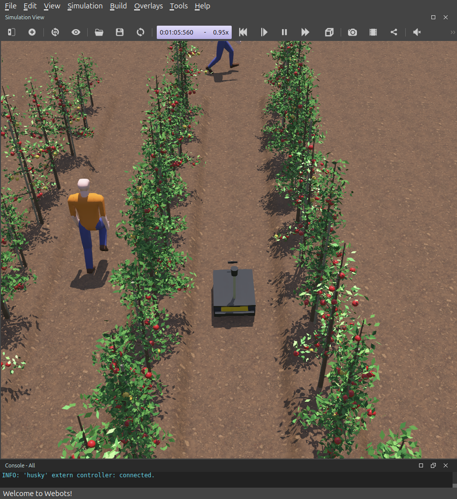
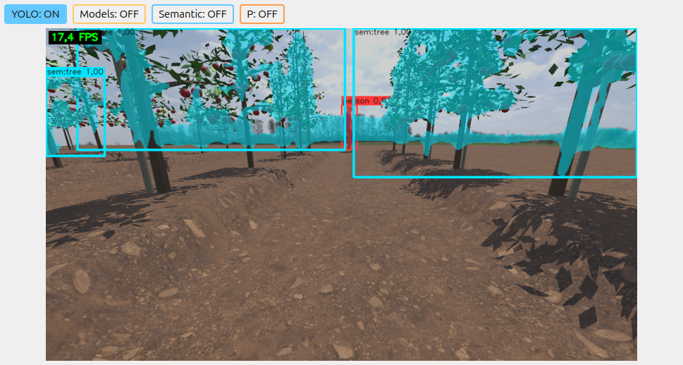
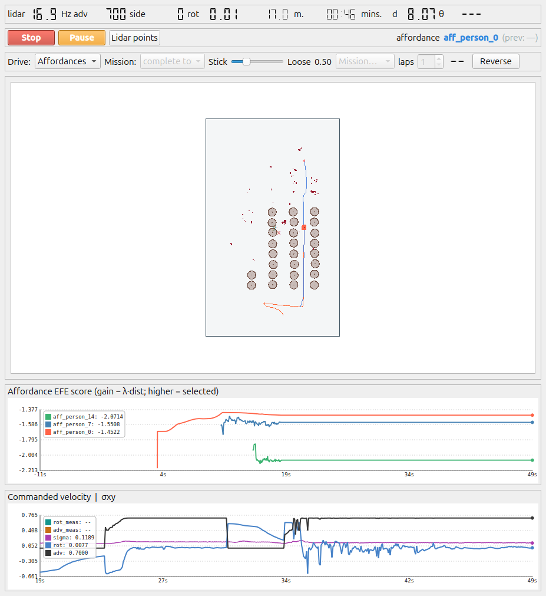

(experiments/images/AGB_Logo.png)

# AiGB_UEx_Navigation — autonomous navigation of a Husky A300 in an apple orchard

Cognitive stack for a **Clearpath Husky A300** agricultural robot simulated in **Webots**. The robot localizes
itself with GNSS, IMU and wheel odometry; builds a semantic map of the orchard (trunks, foliage, unmodelled
obstacles); detects and tracks the workers with the ZED stereo camera and the LiDAR; and navigates autonomously
along the corridors between the tree rows.

It is built on **RoboComp** and the shared **DSR** graph (cortex): every concept of the world (the robot, the
field, the trunks, the vegetation, the people, whatever no concept explains) is maintained by an independent agent
that publishes it in the graph, and navigation reads the resulting graph.



| Perception (ZED + YOLO26) | Controller map while navigating |
|---|---|
|  |  |

**Status:** localization, trunk mapping, people tracking and autonomous navigation work in simulation. The results
of the experiment campaign are in [`experiments/`](experiments/README.md).

## How it works

```
 Webots (husky_apple.wbt)
   │  webots-bridge: skid-steer base, GPS, IMU, ZED, helios LiDAR (Ice + DDS)
   ▼
 Sensorimotor layer ── lidar3d_dds (helios) · zed_camera · imu_dds
   │
   ▼
 Shared DSR graph ◄──► cognitive-layer agents
   robot_concept        the robot's body and sensors (husky.json)
   openfield_concept    localization: EKF with GNSS + IMU + wheels → field node (ENU field frame)
   retina               YOLO26 on the ZED: people (segmentation and pose) and vegetation (ADE20K)
   human_concept        people: 3D skeleton and tracking with the ZED and the LiDAR
   vegetation_concept   foliage (canopies) → what occludes what
   trunk_concept        trunks: low band of the "tree" class confirmed by the LiDAR
   residual_concept     occupancy grid of whatever no concept explains
   controller           planner and base control
```

| Component | What it does |
|---|---|
| `webots-agri/` | Robot (`HuskyA300.proto`), procedural apple tree (`AppleTree.proto`), tilled ground, the `husky_apple.wbt` world and the row generator |
| `webots-bridge/` | Webots → RoboComp bridge: skid-steer base, GPS (WGS84 → local frame), sensors and, optionally, the GNSS degradation used by the experiments |
| `robocomp-robolab/` | Sensor drivers: `lidar3d_dds` (helios), `zed_camera`, `imu_dds`, Xbox gamepad |
| `active_inference/` | DSR cognitive agents (listed above), shared modules (`common/`) and launchers (`utils/`). `row_metaconcept` (tree rows) exists but is disabled |
| `experiments/` | E1–E5 experiment campaign: orchestrator, modular variant configuration, analyses and reports |

## 1. Base installation (outside this repository)

Tested on **Ubuntu 24.04** with an NVIDIA GPU.

1. **RoboComp** — <https://github.com/robocomp/robocomp>. Follow its installation guide (it also installs ZeroC
   Ice, which RoboComp uses between components). It must end up in `~/robocomp`, with `core`, `interfaces`, `tools`
   and `cmake`.
2. **cortex (DSR graph)** — <https://github.com/robocomp/cortex> (`development` branch). Install it in `/usr/local`
   with its dependencies (eProsima Fast-DDS and Fast-CDR, Qt6, Eigen, cppitertools, libQGLViewer) and the `pydsr`
   Python module. This project also needs the **`field`** node type: add `REGISTER_NODE_TYPE(field)` to
   `core/include/dsr/core/types/type_checking/dsr_node_type.h` and reinstall cortex.
3. **Webots R2025a** — <https://cyberbotics.com> (or <https://github.com/cyberbotics/webots/releases>), installed in
   `/usr/local/webots`. The first start needs network access to download some PROTOs.
4. **ONNX Runtime 1.30 with CUDA** — <https://github.com/microsoft/onnxruntime/releases>, unpacked in
   `/opt/onnxruntime`.
5. **TensorRT 10** (optional, recommended: ~4× faster than CUDA). It must be version 10, the one ONNX Runtime 1.30
   expects:

   ```bash
   sudo apt install libnvinfer10=10.16.1.11-1+cuda13.2 libnvinfer-plugin10=10.16.1.11-1+cuda13.2 libnvonnxparsers10=10.16.1.11-1+cuda13.2
   sudo apt-mark hold libnvinfer10 libnvinfer-plugin10 libnvonnxparsers10
   ```

6. **Other libraries** (apt): Embree, TBB, Qt6, Eigen, tomlplusplus. For the experiments, Python with `numpy`,
   `pandas`, `scipy`, `matplotlib` and `python-xlib`.

## 2. This repository

```bash
cd ~/robocomp
git clone https://github.com/Nosl3n/AiGB_UEx_Navigation.git      # must end up in ~/robocomp/AiGB_UEx_Navigation
```

The launchers use that path.

**`retina` models** (not versioned). Export them from the official Ultralytics weights and place them in
`active_inference/retina/models/yolo26/`:

```bash
pip install ultralytics
for m in yolo26x-seg yolo26x-pose yolo26x-sem-ade20k; do
  yolo export model=$m.pt format=onnx opset=17 simplify=True end2end=False
done
```

| Model | Use |
|---|---|
| `yolo26x-seg` | person masks → `human_concept` |
| `yolo26x-pose` | 3D person skeletons → `human_concept` |
| `yolo26x-sem-ade20k` | semantic segmentation of vegetation → `trunk_concept`, `vegetation_concept` |

On the first start TensorRT builds its engines (1–2 min) in `active_inference/retina/.trt_cache/`.

**Build.** Each component is built in its own folder, with **at most `-j8`** (more threads can exhaust the
memory):

```bash
cmake -B build && make -C build -j8
```

Components: `webots-bridge`;
`robocomp-robolab/components/hardware/{laser/lidar3d_dds,camera/zed_camera,imu/imu_dds}`;
`active_inference/{robot_concept,openfield_concept,residual_concept,controller,retina,human_concept,vegetation_concept,trunk_concept}`.

## 3. Run

```bash
./apple.bash            # Webots with husky_apple.wbt + sensorimotor layer + cognitive layer
./apple.bash --route    # ... and also drives a fixed route along the corridors
./apple.bash --stop     # stops everything in order: cognitive layer, sensorimotor layer and Webots
```

- **Navigation goal:** click on the controller's 2D view (press *Run*), or
  `python3 active_inference/utils/send_goal.py X Y` (metres in the field frame: x east, y north).
- **Xbox gamepad:** forward with the left stick, turn with the right one.
- **Web monitor** of the agents' state: <http://127.0.0.1:8080>.
- Layer-by-layer start-up and launcher details: [`active_inference/utils/README.md`](active_inference/utils/README.md).

## 4. The robot and the orchard

- **Husky A300:** 4 skid-steer wheels; 3D LiDAR `helios` (50 layers, 110° vertical, 30 m); ZED stereo camera; IMU;
  GNSS in WGS84 referenced next to the University of Extremadura campus in Badajoz.
- **Orchard:** 5 rows × 12 tall-spindle apple trees (1.3–3.2 m tall, canopies above the GNSS antenna), 2.5 m
  corridors, tilled ground with raised beds. Two workers walk through the orchard.
- **World frame:** the graph's `field` node (ENU), created by `openfield_concept`.

## 5. Experiments

[`experiments/`](experiments/README.md) holds the E1–E5 campaign (localization with degraded GNSS, people tracking,
trunk map, integrated navigation and performance), with an orchestrator that switches every case on or off
(GNSS degradation, ablations, sensor modalities) by changing one configuration key, without touching the repository
configs. Results summary: [`experiments/results/SUMMARY.md`](experiments/results/SUMMARY.md).

## Origin and license

The code starts from `robocomp/active_inference` (`main` @ `5dc985e`), `robocomp/webots-bridge` (`main` @ `486e233`)
and `robocomp/robocomp-robolab` (`master` @ `1cc4825`), by RoboLab (University of Extremadura), keeping the
components the Husky uses. It is distributed under the **GPL-3.0** license, like the code it starts from
([`LICENSE`](LICENSE)).
