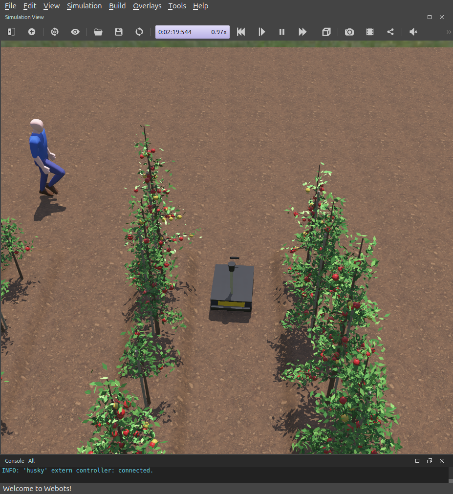
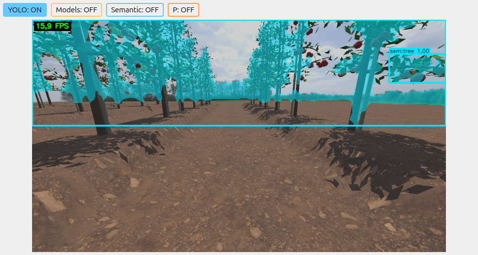
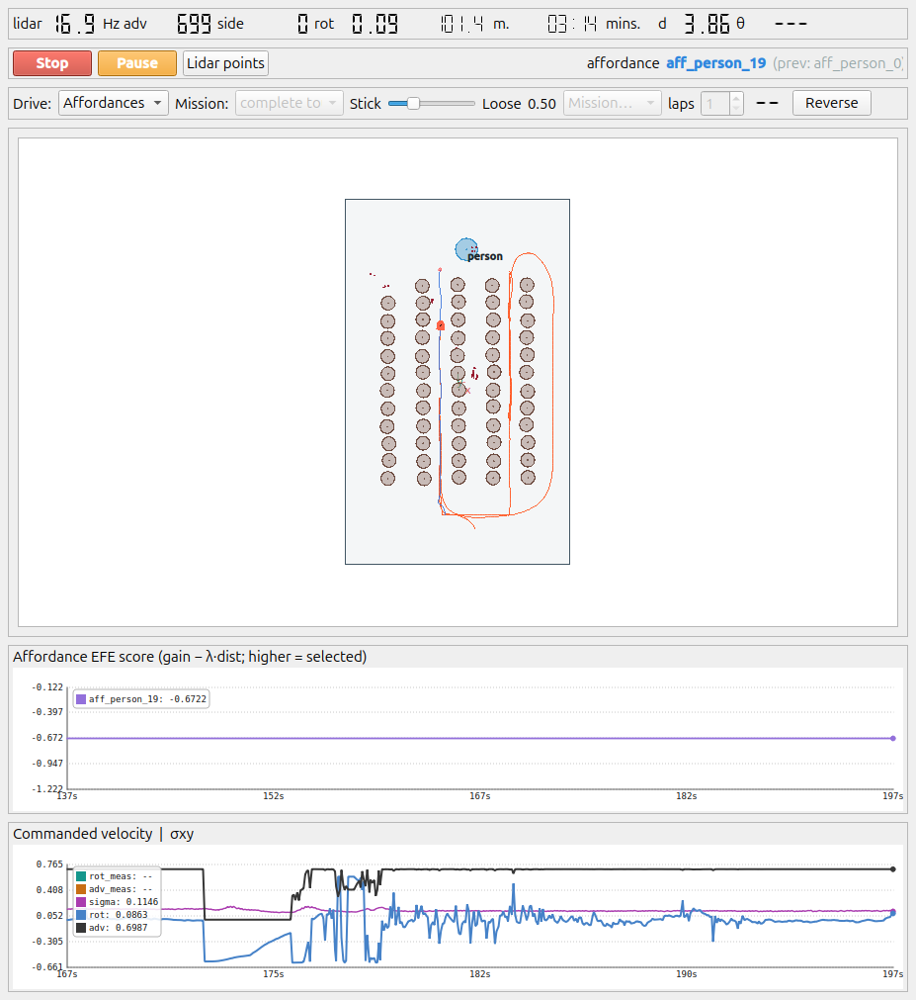

# AiGB_UEx_Navigation — navegación autónoma de un Husky A300 en un huerto de manzanos

Pila cognitiva para un robot agrícola **Clearpath Husky A300** simulado en **Webots**. El robot se localiza con
GNSS, IMU y odometría; construye un mapa semántico del huerto (troncos, follaje, obstáculos no modelados);
detecta y sigue a los trabajadores con la cámara estéreo ZED y el LiDAR; y navega de forma autónoma por los
pasillos entre las hileras de árboles.

Está construida sobre **RoboComp** y el grafo compartido **DSR** (cortex): cada concepto del mundo (el robot, el
campo, los troncos, la vegetación, las personas, lo que ningún concepto explica) lo mantiene un agente
independiente que lo publica en el grafo, y la navegación lee el grafo resultante.



| Percepción (ZED + YOLO26) | Mapa del controller durante la navegación |
|---|---|
|  |  |

**Estado:** localización, mapa de troncos, seguimiento de personas y navegación autónoma funcionan en simulación.
Los resultados de la campaña de experimentos están en [`experiments/`](experiments/README.md).

## Cómo funciona

```
 Webots (husky_apple.wbt)
   │  webots-bridge: base skid-steer, GPS, IMU, ZED, LiDAR helios (Ice + DDS)
   ▼
 Capa sensoriomotora ── lidar3d_dds (helios) · zed_camera · imu_dds
   │
   ▼
 Grafo DSR compartido ◄──► agentes de la capa cognitiva
   robot_concept        cuerpo del robot y sus sensores (husky.json)
   openfield_concept    localización: EKF con GNSS + IMU + ruedas → nodo field (marco ENU del campo)
   retina               YOLO26 sobre la ZED: personas (segmentación y pose) y vegetación (ADE20K)
   human_concept        personas: esqueleto 3D y seguimiento con la ZED y el LiDAR
   vegetation_concept   follaje (copas) → qué tapa qué
   trunk_concept        troncos: banda baja de la clase "tree" confirmada por el LiDAR
   residual_concept     rejilla de ocupación de lo que ningún concepto explica
   controller           planificador y control de la base
```

| Componente | Qué hace |
|---|---|
| `webots-agri/` | Robot (`HuskyA300.proto`), manzano procedural (`AppleTree.proto`), suelo labrado, mundo `husky_apple.wbt` y generador de hileras |
| `webots-bridge/` | Puente Webots → RoboComp: base skid-steer, GPS (WGS84 → marco local), sensores y, opcionalmente, la degradación GNSS de los experimentos |
| `robocomp-robolab/` | Drivers de sensores: `lidar3d_dds` (helios), `zed_camera`, `imu_dds`, mando Xbox |
| `active_inference/` | Agentes cognitivos DSR (lista de arriba), módulos compartidos (`common/`) y lanzadores (`utils/`). `row_metaconcept` (hileras) existe pero está desactivado |
| `experiments/` | Campaña de experimentos E1–E5: orquestador, configuración modular de variantes, análisis e informes |

## 1. Instalación básica (fuera de este repositorio)

Probado en **Ubuntu 24.04** con GPU NVIDIA.

1. **RoboComp** — <https://github.com/robocomp/robocomp>. Sigue su guía de instalación (instala también ZeroC
   Ice, que usa RoboComp para comunicar componentes). Debe quedar en `~/robocomp`, con `core`, `interfaces`,
   `tools` y `cmake`.
2. **cortex (grafo DSR)** — <https://github.com/robocomp/cortex> (rama `development`). Instálalo en `/usr/local`
   con sus dependencias (Fast-DDS y Fast-CDR de eProsima, Qt6, Eigen, cppitertools, libQGLViewer), y el módulo de
   Python `pydsr`. Este proyecto necesita además el tipo de nodo **`field`**: añade `REGISTER_NODE_TYPE(field)` en
   `core/include/dsr/core/types/type_checking/dsr_node_type.h` y reinstala cortex.
3. **Webots R2025a** — <https://cyberbotics.com> (o <https://github.com/cyberbotics/webots/releases>), instalado en
   `/usr/local/webots`. La primera vez necesita red para descargar algunos PROTO.
4. **ONNX Runtime 1.30 con CUDA** — <https://github.com/microsoft/onnxruntime/releases>, descomprimido en
   `/opt/onnxruntime`.
5. **TensorRT 10** (opcional, recomendado: ~4× más rápido que CUDA). Tiene que ser la versión 10, la que espera
   ONNX Runtime 1.30:

   ```bash
   sudo apt install libnvinfer10=10.16.1.11-1+cuda13.2 libnvinfer-plugin10=10.16.1.11-1+cuda13.2 libnvonnxparsers10=10.16.1.11-1+cuda13.2
   sudo apt-mark hold libnvinfer10 libnvinfer-plugin10 libnvonnxparsers10
   ```

6. **Otras librerías** (apt): Embree, TBB, Qt6, Eigen, tomlplusplus. Para los experimentos, Python con `numpy`,
   `pandas`, `scipy`, `matplotlib` y `python-xlib`.

## 2. Este repositorio

```bash
cd ~/robocomp
git clone https://github.com/Nosl3n/AiGB_UEx_Navigation.git      # debe quedar en ~/robocomp/AiGB_UEx_Navigation
```

Los lanzadores usan esa ruta.

**Modelos de `retina`** (no se versionan). Se exportan de los pesos oficiales de Ultralytics y se dejan en
`active_inference/retina/models/yolo26/`:

```bash
pip install ultralytics
for m in yolo26x-seg yolo26x-pose yolo26x-sem-ade20k; do
  yolo export model=$m.pt format=onnx opset=17 simplify=True end2end=False
done
```

| Modelo | Uso |
|---|---|
| `yolo26x-seg` | máscaras de personas → `human_concept` |
| `yolo26x-pose` | esqueletos 3D de personas → `human_concept` |
| `yolo26x-sem-ade20k` | segmentación semántica de vegetación → `trunk_concept`, `vegetation_concept` |

En el primer arranque, TensorRT construye sus engines (1–2 min) en `active_inference/retina/.trt_cache/`.

**Compilar.** Cada componente se compila en su carpeta, con **`-j8` como máximo** (con más hilos la compilación
puede agotar la memoria):

```bash
cmake -B build && make -C build -j8
```

Componentes: `webots-bridge`;
`robocomp-robolab/components/hardware/{laser/lidar3d_dds,camera/zed_camera,imu/imu_dds}`;
`active_inference/{robot_concept,openfield_concept,residual_concept,controller,retina,human_concept,vegetation_concept,trunk_concept}`.

## 3. Lanzar

```bash
./apple.bash            # Webots con husky_apple.wbt + capa sensoriomotora + capa cognitiva
./apple.bash --route    # ... y además recorre una ruta fija por los pasillos
./apple.bash --stop     # para todo en orden: capa cognitiva, capa sensoriomotora y Webots
```

- **Objetivo de navegación:** clic en la vista 2D del controller (pulsar *Run*), o
  `python3 active_inference/utils/send_goal.py X Y` (metros en el marco del campo: x este, y norte).
- **Mando Xbox:** avance con el stick izquierdo, giro con el derecho.
- **Monitor web** del estado de los agentes: <http://127.0.0.1:8080>.
- Arranque por capas y detalles de los lanzadores: [`active_inference/utils/README.md`](active_inference/utils/README.md).

## 4. El robot y el huerto

- **Husky A300:** 4 ruedas skid-steer; LiDAR 3D `helios` (50 capas, 110° vertical, 30 m); cámara estéreo ZED;
  IMU; GNSS en WGS84 con referencia junto al campus de la Universidad de Extremadura en Badajoz.
- **Huerto:** 5 hileras × 12 manzanos en eje central (1,3–3,2 m de alto, las copas por encima de la antena
  GNSS), pasillos de 2,5 m, suelo labrado con caballones. Dos trabajadores caminan por el huerto.
- **Marco del mundo:** nodo `field` del grafo (ENU), creado por `openfield_concept`.

## 5. Experimentos

[`experiments/`](experiments/README.md) contiene la campaña E1–E5 (localización con GNSS degradado, seguimiento
de personas, mapa de troncos, navegación integrada y rendimiento), con un orquestador que activa o desactiva cada
caso (degradación GNSS, ablaciones, modalidades de sensor) cambiando una clave de configuración, sin tocar las
configuraciones del repositorio. Resumen de resultados: [`experiments/resultados/RESUMEN.md`](experiments/resultados/RESUMEN.md).

## Origen y licencia

El código parte de `robocomp/active_inference` (`main` @ `5dc985e`), `robocomp/webots-bridge` (`main` @ `486e233`)
y `robocomp/robocomp-robolab` (`master` @ `1cc4825`), de RoboLab (Universidad de Extremadura), de los que se
conservan los componentes que usa el Husky. Se distribuye bajo la licencia **GPL-3.0**, como el código del que
parte ([`LICENSE`](LICENSE)).
