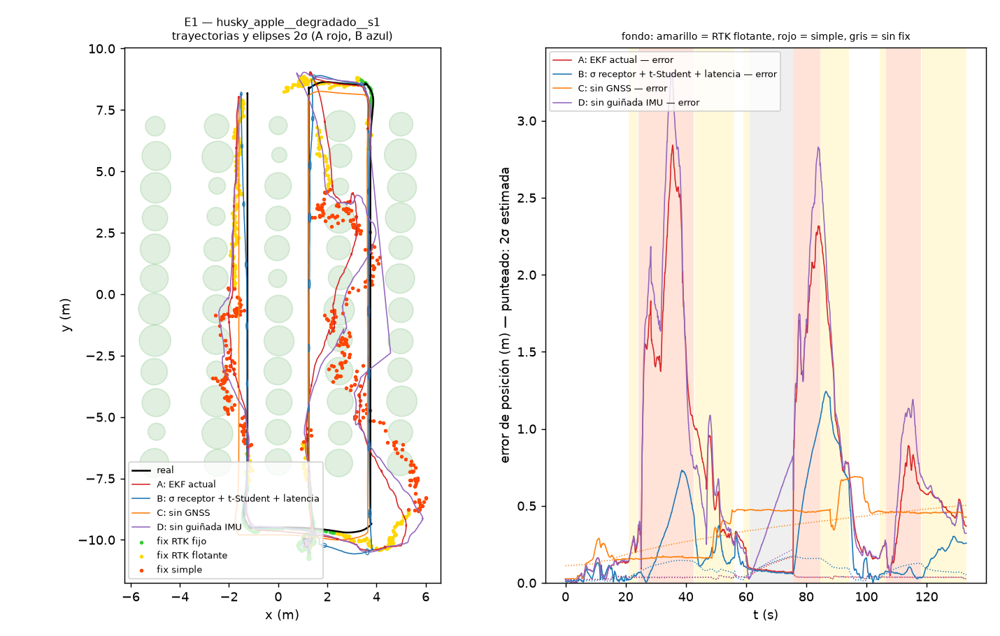
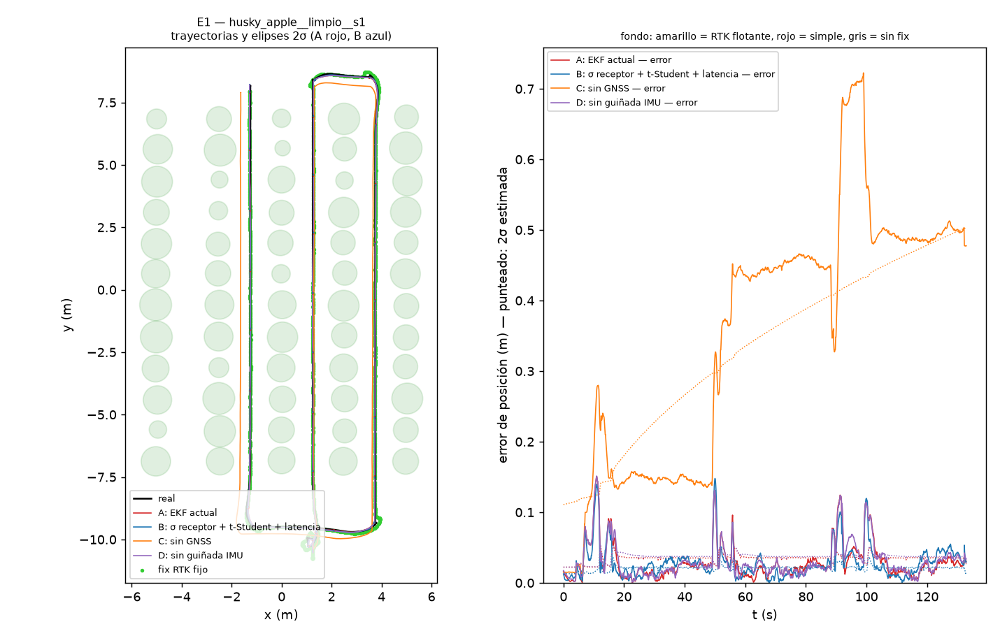

# E1 — Localización con GNSS degradado

Cuatro configuraciones del EKF corren a la vez sobre los MISMOS datos (filtros en sombra de openfield_concept); el robot sigue la misma ruta en todas las ejecuciones (conductor sobre la verdad del simulador). Error evaluado en el instante de la verdad. NEES sobre (x, y, θ): consistente ⇔ media ≈ 3. Intervalo del 95 % de la media de N ejecuciones independientes: χ²(3N)/N (N = 2: [0.62, 7.22]), (N = 10: [1.68, 4.70]).

## Estado del GNSS (porcentaje del tiempo) y error real de los fixes

| mundo | variante | n | RTK fijo % | flotante % | simple % | sin fix % | error fix p95 (m) |
|---|---|---|---|---|---|---|---|
| husky_apple | degradado | 10 | 19.5 | 38.0 | 26.6 | 15.9 | 1.902 |
| husky_apple | limpio | 2 | 100.0 | 0.0 | 0.0 | 0.0 | 0.000 |

Error del fix = |fix entregado − lectura del GPS de Webots| en el instante de medida: mide solo la degradación añadida; no incluye el ruido propio del GPS simulado (σ = 2 cm por eje) ni el desfase que añade la latencia mientras el robot avanza. Los errores de los filtros sí se miden contra la verdad.

## Error y consistencia por configuración (media ± desviación entre ejecuciones)

| mundo | GNSS | configuración | n | error p50 (m) | error p95 (m) | rumbo p50 (°) | rumbo p95 (°) | NEES medio | NEES mediana |
|---|---|---|---|---|---|---|---|---|---|
| husky_apple | degradado | A: EKF actual | 10 | 0.472 ± 0.152 | 1.675 ± 0.474 | 0.08 | 0.24 | 3240.2 ± 1361.3 | 867.00 |
| husky_apple | degradado | B: σ receptor + t-Student + latencia | 10 | 0.222 ± 0.086 | 0.984 ± 0.272 | 0.08 | 0.24 | 126.7 ± 73.4 | 47.55 |
| husky_apple | degradado | C: sin GNSS | 10 | 0.681 ± 0.559 | 0.874 ± 0.599 | 0.08 | 0.24 | 49.4 ± 108.9 | 31.46 |
| husky_apple | degradado | D: sin guiñada IMU | 10 | 0.508 ± 0.155 | 1.868 ± 0.501 | 3.59 | 11.83 | 3397.5 ± 1197.7 | 967.77 |
| husky_apple | limpio | A: EKF actual | 2 | 0.022 ± 0.001 | 0.092 ± 0.000 | 0.08 | 0.24 | 9.4 ± 0.1 | 3.93 |
| husky_apple | limpio | B: σ receptor + t-Student + latencia | 2 | 0.024 ± 0.000 | 0.078 ± 0.000 | 0.08 | 0.24 | 19.9 ± 0.3 | 8.62 |
| husky_apple | limpio | C: sin GNSS | 2 | 0.458 ± 0.016 | 0.654 ± 0.024 | 0.08 | 0.24 | 6.3 ± 0.2 | 5.37 |
| husky_apple | limpio | D: sin guiñada IMU | 2 | 0.023 ± 0.000 | 0.091 ± 0.001 | 0.27 | 1.22 | 9.4 ± 0.1 | 3.91 |

