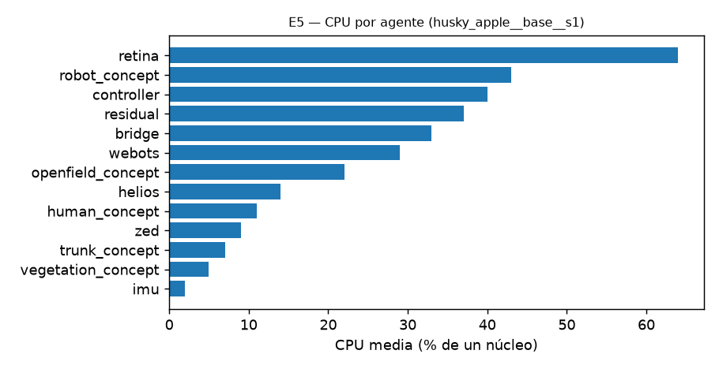

# E5 — Rendimiento computacional

PC: AMD Ryzen 9 9950X3D (16 núcleos / 32 hilos), 60 GiB RAM, NVIDIA GeForce RTX 5070 Ti 16 GB (driver 595.91), Ubuntu 24.04.5, kernel 7.0.

Ejecución medida: husky_apple__base__s1. CPU de la máquina media 11 % (de 3200 %), GPU media 34 %.

## Frecuencias (mediana / mínimo tras el arranque)

| flujo | mediana (Hz) | mínimo (Hz) | requisito |
|---|---|---|---|
| pose en el grafo (anillo RT robot→field) | 50.0 | 48.7 | ≥ 50 Hz |
| openfield_concept (pose EKF) | 51.0 | 50.0 |  |
| residual (rejilla residual) | 10.0 | 9.8 | ≥ 2 Hz |
| controller (planificador) | 16.8 | 9.4 |  |
| retina (bucle) | 40.0 | 40.0 |  |
| retina: fotogramas ZED procesados | 14.0 | 11.1 |  |
| trunk_concept | 20.0 | 20.0 |  |
| vegetation_concept | 20.0 | 20.0 |  |
| human_concept | 20.0 | 20.0 |  |
| robot_concept | 10.0 | 10.0 |  |
| zed (driver) | 59.0 | 59.0 |  |
| helios (LiDAR) | 17.0 | 13.0 |  |

## Latencias (ms)

| medida | n | mediana | p95 | máx |
|---|---|---|---|---|
| pose del robot en el grafo (edad al leerla) | 196 | 18 | 26 | 35 |
| personas en el grafo (edad de la última muestra RT) | 345 | 58 | 990 | 2318 |
| controller: edad máxima del comando de velocidad (por informe) | 332 | 43 | 65 | 125 |

## CPU / memoria / GPU por proceso

| proceso | CPU media (%) | CPU máx (%) | RSS (MB) | memoria GPU (MB) |
|---|---|---|---|---|
| retina | 64 | 89 | 2580 | 1562 |
| robot_concept | 43 | 64 | 276 | — |
| controller | 40 | 94 | 176 | — |
| residual | 37 | 46 | 329 | — |
| bridge | 33 | 36 | 68 | — |
| webots | 29 | 39 | 1555 | — |
| openfield_concept | 22 | 33 | 146 | — |
| helios | 14 | 15 | 105 | — |
| human_concept | 11 | 17 | 156 | — |
| zed | 9 | 10 | 162 | — |
| trunk_concept | 7 | 11 | 147 | — |
| vegetation_concept | 5 | 7 | 100 | — |
| imu | 2 | 2 | 72 | — |

## E3 con el modelo semántico más lento (Semantic.decimation = 4)

La evidencia de troncos se pondera por 'mirada de referencia' (LookPeriodMs = 530 ms); si la normalización funciona, el mapa no depende de cuántas inferencias por segundo haga la GPU.

| ejecución | miradas semánticas/s (aprox.) | publicados | precisión | exhaustividad | F1 | error (m) | falsos/h | elim. erróneas/h |
|---|---|---|---|---|---|---|---|---|
| E4/base/s1 | 11.0 | 60 | 1.00 | 1.00 | 1.00 | 0.067 | 0.0 | 0.0 |
| E4/base/s2 | 10.8 | 60 | 1.00 | 1.00 | 1.00 | 0.066 | 0.0 | 0.0 |
| E4/base/s3 | 11.0 | 60 | 1.00 | 1.00 | 1.00 | 0.069 | 0.0 | 0.0 |
| E5/semantica_lenta/s1 | 2.5 | 60 | 0.98 | 0.98 | 0.98 | 0.061 | 12.8 | 0.0 |
