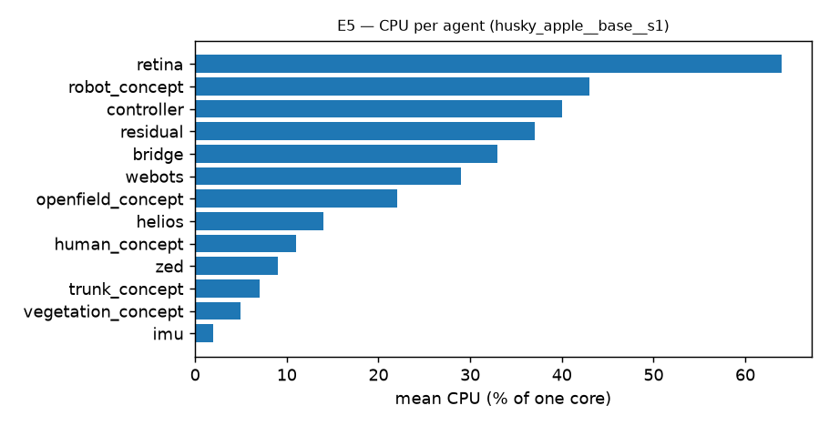

# Experiment campaign — summary

## Machine

AMD Ryzen 9 9950X3D (16 cores / 32 threads) · 60 GiB RAM (no swap) · NVIDIA GeForce RTX 5070 Ti 16 GB (driver 595.91)
· Ubuntu 24.04.5 LTS, kernel 7.0 · Webots R2025a.

## YOLO models in use (all in `retina`: Ultralytics YOLO26 exported to ONNX, TensorRT FP16)

| Model | Block of `retina/etc/config_husky.toml` | Task | Consumer |
|---|---|---|---|
| `yolo26x-seg.onnx` (COCO-80 instance segmentation) | `[Yolo]` | **person** masks (`accepted_labels = ["person"]`) on the ZED image | `human_concept` (and the person exclusion in trunks/vegetation) |
| `yolo26x-pose.onnx` (pose, 17 COCO keypoints → BODY_18) | `[HumanPose]` | 3D **skeletons** of the people (ZED depth) → `skeleton` node | `human_concept` |
| `yolo26x-sem-ade20k.onnx` (ADE20K-150 semantic segmentation) | `[Semantic]` | ADE20K **vegetation** classes (tree, plant, …) → vegetation masks in the `masks` node | `trunk_concept`, `vegetation_concept` |

## Conclusions

Internal campaign in simulation (Webots R2025a, apple orchard `husky_apple.wbt`), with few repetitions except in E1
(10 seeds).

- **E1 · Localization with degraded GNSS.** Under the canopies the degradation layer produces 20 % RTK fixed, 38 %
  RTK float, 27 % single and 16 % no fix. The current EKF (A) gives a p50 error of 0.47 m and a p95 of 1.68 m, with a
  mean NEES far above the 95 % interval ([1.68, 4.70] for N = 10): its covariance does not reflect the actual error.
  B (receiver σ + Student-t likelihood + latency compensation) lowers the error to p50 0.22 m / p95 0.98 m and the
  NEES to ~130; it improves, but stays outside the interval, because the receiver error is correlated in time and
  multipath does not show in its σ. Without GNSS (C) the p50 error over the route (~2.5 min) is ~0.7 m. Without the
  IMU yaw (D) the p95 heading error goes from 0.2° to ~12°. With clean GNSS, A has a p50 error of 2 cm.
- **E2 · People tracking.** ZED + LiDAR fusion against ZED only: MOTA 0.30 vs 0.13; MOTP 0.18 m vs 0.44 m (the LiDAR
  places a person more precisely than stereo depth); identity kept in 6 of 18 occlusions (up to 64 s) vs 0 of 32.
  Fusion produces more false births (17 vs 4), on the tree canopies.
- **E3 · Trunk map.** 60/60 trunks, F1 = 1.00, mean error 6.7 cm, no false trunks and no wrong removals. The two
  ablations do not change the result in this world: there are no false semantic candidates in the trunk band and no
  occlusions long enough. With the semantic model at ¼ rate (11 → 2.5 looks/s) F1 is 0.98: the per-reference-look
  normalisation keeps the map.
- **E4 · Integrated navigation.** 3/3 missions completed (9/9 waypoints), ~250 s per mission, minimum clearance
  0.57 m to trunks and 0.73 m to people, no collisions. GNSS not degraded; localization error p50 4 cm / p95 8 cm.
- **E5 · Performance.** Pose at 50 Hz, residual grid at 10 Hz, controller ~17 Hz, ZED processed at ~14 fps. Pose
  latency in the graph 18 ms (p95 26 ms). Total CPU ~11 % of the machine; `retina` is the most expensive process
  (64 % of one core, 1.6 GB of GPU memory).

## E1 — Localization with degraded GNSS

Four EKF configurations run at once on the SAME data (openfield_concept shadow filters); the robot follows the same route in every run (driver on the simulator's ground truth). Errors are evaluated at the ground-truth timestamp. NEES over (x, y, θ): consistent ⇔ mean ≈ 3. 95 % interval of the mean of N independent runs: χ²(3N)/N (N = 2: [0.62, 7.22]), (N = 10: [1.68, 4.70]).

### GNSS state (share of time) and fix error

| world | variant | n | RTK fixed % | RTK float % | single % | no fix % | fix error p95 (m) |
|---|---|---|---|---|---|---|---|
| husky_apple | clean | 2 | 100.0 | 0.0 | 0.0 | 0.0 | 0.000 |
| husky_apple | degraded | 10 | 19.5 | 38.0 | 26.6 | 15.9 | 1.902 |

Fix error = |delivered fix − Webots GPS reading| at the measurement instant: it measures only the added degradation; it does not include the simulated GPS's own noise (σ = 2 cm per axis) nor the offset the latency adds while the robot moves. The filters' errors are measured against the ground truth.

### Error and consistency per configuration (mean ± std across runs)

| world | GNSS | configuration | n | error p50 (m) | error p95 (m) | heading p50 (°) | heading p95 (°) | NEES mean | NEES median |
|---|---|---|---|---|---|---|---|---|---|
| husky_apple | clean | A: current EKF | 2 | 0.022 ± 0.001 | 0.092 ± 0.000 | 0.08 | 0.24 | 9.4 ± 0.1 | 3.93 |
| husky_apple | clean | B: receiver σ + Student-t + latency | 2 | 0.024 ± 0.000 | 0.078 ± 0.000 | 0.08 | 0.24 | 19.9 ± 0.3 | 8.62 |
| husky_apple | clean | C: no GNSS | 2 | 0.458 ± 0.016 | 0.654 ± 0.024 | 0.08 | 0.24 | 6.3 ± 0.2 | 5.37 |
| husky_apple | clean | D: no IMU yaw | 2 | 0.023 ± 0.000 | 0.091 ± 0.001 | 0.27 | 1.22 | 9.4 ± 0.1 | 3.91 |
| husky_apple | degraded | A: current EKF | 10 | 0.472 ± 0.152 | 1.675 ± 0.474 | 0.08 | 0.24 | 3240.2 ± 1361.3 | 867.00 |
| husky_apple | degraded | B: receiver σ + Student-t + latency | 10 | 0.222 ± 0.086 | 0.984 ± 0.272 | 0.08 | 0.24 | 126.7 ± 73.4 | 47.55 |
| husky_apple | degraded | C: no GNSS | 10 | 0.681 ± 0.559 | 0.874 ± 0.599 | 0.08 | 0.24 | 49.4 ± 108.9 | 31.46 |
| husky_apple | degraded | D: no IMU yaw | 10 | 0.508 ± 0.155 | 1.868 ± 0.501 | 3.59 | 11.83 | 3397.5 ± 1197.7 | 967.77 |

## E2 — People tracking

Evaluated region: workers within 10.0 m of the robot (all around it). CLEAR-MOT matching with a 1.0 m gate. 'Occlusion' = a stretch in which the worker is not visible to the camera (outside the ±49° field of view, or a canopy on the line of sight); it counts as kept if the same track follows the worker before and after it. Variants: fusion (ZED + LiDAR) and ZED only (HumanLidar.Enabled = false). The world has 4 workers, so the IDSW denominator is 4 × the run's minutes.

| variant | n | MOTA | MOTP (m) | IDSW/(worker·min) | longest kept occlusion (s) | false births |
|---|---|---|---|---|---|---|
| fusion | 1 | 0.30 | 0.176 | 1.575 | 64.0 | 17.0 |
| zed_only | 1 | 0.13 | 0.436 | 2.145 | 0.0 | 4.0 |

| run | MOTA | MOTP (m) | FN | FP | IDSW | IDSW/(worker·min) | longest occlusion (s) | occlusions kept | false births | tracks | min |
|---|---|---|---|---|---|---|---|---|---|---|---|
| exp_people__fusion__s2 | 0.30 | 0.176 | 3795 | 4176 | 45 | 1.575 | 64.0 | 6/18 | 17 | 47 | 7.1 |
| exp_people__zed_only__s2 | 0.13 | 0.436 | 9159 | 1129 | 61 | 2.145 | 0.0 | 0/32 | 4 | 60 | 7.1 |

## E3 — Trunk map against the world's ground truth

Hungarian matching with a 0.25 m gate against the 60 tree positions of the .wbt (written by gen_apple_rows.py). 'Recall (seen)' counts only the trees that came within 4 m of the robot (the ZED's absence range). The base runs are the E4 missions.

### Summary per variant (mean over runs)

| variant | n | precision | recall | recall (seen) | F1 | mean error (m) | false trunks/h | wrong removals/h |
|---|---|---|---|---|---|---|---|---|
| base | 3 | 1.00 | 1.00 | 1.00 | 1.00 | 0.068 | 0.0 | 0.0 |
| no_lidar_confirm | 1 | 1.00 | 1.00 | 1.00 | 1.00 | 0.071 | 0.0 | 0.0 |
| no_pvis | 1 | 1.00 | 1.00 | 1.00 | 1.00 | 0.058 | 0.0 | 0.0 |
| slow_semantic | 1 | 0.98 | 0.98 | 0.98 | 0.98 | 0.061 | 12.8 | 0.0 |

### Per run

| run | variant | published | hits | precision | recall | recall seen (n) | F1 | error (m) | false | wrong removals |
|---|---|---|---|---|---|---|---|---|---|---|
| E4/husky_apple__base__s1 | base | 60 | 60 | 1.00 | 1.00 | 1.00 (60) | 1.00 | 0.067 | 0 (0.0/h) | 0 (0.0/h) |
| E4/husky_apple__base__s2 | base | 60 | 60 | 1.00 | 1.00 | 1.00 (60) | 1.00 | 0.066 | 0 (0.0/h) | 0 (0.0/h) |
| E4/husky_apple__base__s3 | base | 60 | 60 | 1.00 | 1.00 | 1.00 (60) | 1.00 | 0.069 | 0 (0.0/h) | 0 (0.0/h) |
| E3/husky_apple__no_lidar_confirm__s1 | no_lidar_confirm | 60 | 60 | 1.00 | 1.00 | 1.00 (60) | 1.00 | 0.071 | 0 (0.0/h) | 0 (0.0/h) |
| E3/husky_apple__no_pvis__s1 | no_pvis | 60 | 60 | 1.00 | 1.00 | 1.00 (60) | 1.00 | 0.058 | 0 (0.0/h) | 0 (0.0/h) |
| E5/husky_apple__slow_semantic__s1 | slow_semantic | 60 | 59 | 0.98 | 0.98 | 0.98 (60) | 0.98 | 0.061 | 1 (12.8/h) | 0 (0.0/h) |

## E4 — Integrated navigation

Missions: 3. Waypoint success: 100.0 %. Complete missions: 100.0 %.
Mean mission time: 248.7 s. Minimum clearance to trunks: 0.57 m; to people: 0.73 m. Collisions (contacts of the 0.99x0.686 m body with a trunk / with a person's 0.25 m disc): 0 / 0.

Clearance = distance from the body rectangle (Webots ground-truth pose) to the trunk (real radius) or to the person. GNSS not degraded; the published (A) filter drives.

| run | waypoints | time (s) | path (m) | trunk clearance (m) | person clearance (m) | trunk coll. | person coll. | loc. error p50 (m) | loc. error p95 (m) |
|---|---|---|---|---|---|---|---|---|---|
| husky_apple__base__s1 | 9/9 | 278.3 | 154.7 | 0.58 | 1.16 | 0 | 0 | 0.041 | 0.077 |
| husky_apple__base__s2 | 9/9 | 231.2 | 121.6 | 0.57 | 1.09 | 0 | 0 | 0.040 | 0.079 |
| husky_apple__base__s3 | 9/9 | 236.7 | 126.7 | 0.58 | 0.73 | 0 | 0 | 0.041 | 0.081 |

## E5 — Computational performance

PC: AMD Ryzen 9 9950X3D (16 cores / 32 threads), 60 GiB RAM, NVIDIA GeForce RTX 5070 Ti 16 GB (driver 595.91), Ubuntu 24.04.5, kernel 7.0.

Measured run: husky_apple__base__s1. Mean machine CPU 11 % (of 3200 %), mean GPU 34 %.

### Rates (median / minimum after start-up)

| stream | median (Hz) | minimum (Hz) | requirement |
|---|---|---|---|
| pose in the graph (RT ring robot→field) | 50.0 | 48.7 | ≥ 50 Hz |
| openfield_concept (pose EKF) | 51.0 | 50.0 |  |
| residual (residual grid) | 10.0 | 9.8 | ≥ 2 Hz |
| controller (planner) | 16.8 | 9.4 |  |
| retina (loop) | 40.0 | 40.0 |  |
| retina: ZED frames processed | 14.0 | 11.1 |  |
| trunk_concept | 20.0 | 20.0 |  |
| vegetation_concept | 20.0 | 20.0 |  |
| human_concept | 20.0 | 20.0 |  |
| robot_concept | 10.0 | 10.0 |  |
| zed (driver) | 59.0 | 59.0 |  |
| helios (LiDAR) | 17.0 | 13.0 |  |

### Latencies (ms)

| measure | n | median | p95 | max |
|---|---|---|---|---|
| robot pose in the graph (age when read) | 196 | 18 | 26 | 35 |
| people in the graph (age of the last RT sample) | 345 | 58 | 990 | 2318 |
| controller: max age of the velocity command (per report) | 332 | 43 | 65 | 125 |

### CPU / memory / GPU per process

| process | mean CPU (%) | max CPU (%) | RSS (MB) | GPU memory (MB) |
|---|---|---|---|---|
| retina | 64 | 89 | 2580 | 1562 |
| robot_concept | 43 | 64 | 276 | — |
| controller | 40 | 94 | 176 | — |
| residual | 37 | 46 | 329 | — |
| bridge | 33 | 36 | 68 | — |
| webots | 29 | 39 | 1555 | — |
| openfield_concept | 22 | 33 | 146 | — |
| helios | 14 | 15 | 105 | — |
| human_concept | 11 | 17 | 156 | — |
| zed | 9 | 10 | 162 | — |
| trunk_concept | 7 | 11 | 147 | — |
| vegetation_concept | 5 | 7 | 100 | — |
| imu | 2 | 2 | 72 | — |

### E3 with the semantic model slowed down (Semantic.decimation = 4)

Trunk evidence is weighted per 'reference look' (LookPeriodMs = 530 ms); if the normalisation works, the map does not depend on how many inferences per second the GPU runs.

| run | semantic looks/s (approx.) | published | precision | recall | F1 | error (m) | false/h | wrong removals/h |
|---|---|---|---|---|---|---|---|---|
| E4/base/s1 | 11.0 | 60 | 1.00 | 1.00 | 1.00 | 0.067 | 0.0 | 0.0 |
| E4/base/s2 | 10.8 | 60 | 1.00 | 1.00 | 1.00 | 0.066 | 0.0 | 0.0 |
| E4/base/s3 | 11.0 | 60 | 1.00 | 1.00 | 1.00 | 0.069 | 0.0 | 0.0 |
| E5/slow_semantic/s1 | 2.5 | 60 | 0.98 | 0.98 | 0.98 | 0.061 | 12.8 | 0.0 |
