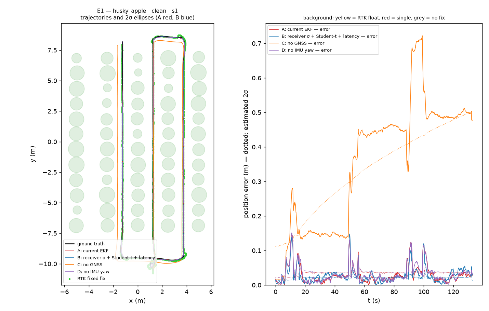
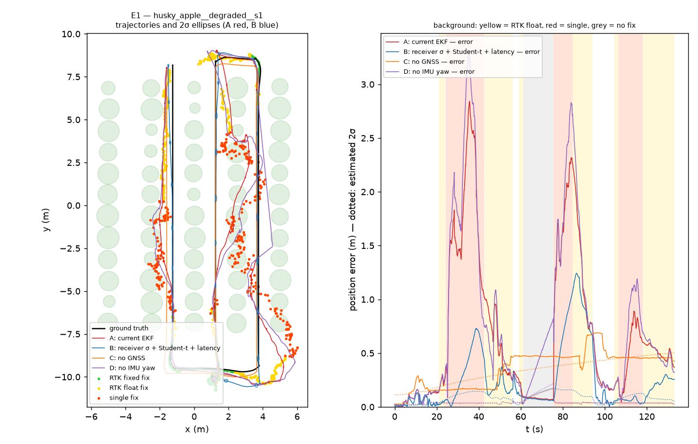

# E1 — Localization with degraded GNSS

Four EKF configurations run at once on the SAME data (openfield_concept shadow filters); the robot follows the same route in every run (driver on the simulator's ground truth). Errors are evaluated at the ground-truth timestamp. NEES over (x, y, θ): consistent ⇔ mean ≈ 3. 95 % interval of the mean of N independent runs: χ²(3N)/N (N = 2: [0.62, 7.22]), (N = 10: [1.68, 4.70]).

## GNSS state (share of time) and fix error

| world | variant | n | RTK fixed % | RTK float % | single % | no fix % | fix error p95 (m) |
|---|---|---|---|---|---|---|---|
| husky_apple | clean | 2 | 100.0 | 0.0 | 0.0 | 0.0 | 0.000 |
| husky_apple | degraded | 10 | 19.5 | 38.0 | 26.6 | 15.9 | 1.902 |

Fix error = |delivered fix − Webots GPS reading| at the measurement instant: it measures only the added degradation; it does not include the simulated GPS's own noise (σ = 2 cm per axis) nor the offset the latency adds while the robot moves. The filters' errors are measured against the ground truth.

## Error and consistency per configuration (mean ± std across runs)

| world | GNSS | configuration | n | error p50 (m) | error p95 (m) | heading p50 (°) | heading p95 (°) | NEES mean | NEES median |
|---|---|---|---|---|---|---|---|---|---|
| husky_apple | clean | A: current EKF | 2 | 0.022 ± 0.001 | 0.092 ± 0.000 | 0.08 | 0.24 | 9.4 ± 0.1 | 3.93 |
| husky_apple | clean | B: receiver σ + Student-t + latency | 2 | 0.024 ± 0.000 | 0.078 ± 0.000 | 0.08 | 0.24 | 19.9 ± 0.3 | 8.62 |
| husky_apple | clean | C: no GNSS | 2 | 0.458 ± 0.016 | 0.654 ± 0.024 | 0.08 | 0.24 | 6.3 ± 0.2 | 5.37 |
| husky_apple | clean | D: no IMU yaw | 2 | 0.023 ± 0.000 | 0.091 ± 0.001 | 0.27 | 1.22 | 9.4 ± 0.1 | 3.91 |
| husky_apple | degraded | A: current EKF | 10 | 0.472 ± 0.152 | 1.675 ± 0.474 | 0.08 | 0.24 | 3240.2 ± 1361.3 | 867.00 |
| husky_apple | degraded | B: receiver σ + Student-t + latency | 10 | 0.222 ± 0.086 | 0.984 ± 0.272 | 0.08 | 0.24 | 126.7 ± 73.4 | 47.55 |
| husky_apple | degraded | C: no GNSS | 10 | 0.681 ± 0.559 | 0.874 ± 0.599 | 0.08 | 0.24 | 49.4 ± 108.9 | 31.46 |
| husky_apple | degraded | D: no IMU yaw | 10 | 0.508 ± 0.155 | 1.868 ± 0.501 | 3.59 | 11.83 | 3397.5 ± 1197.7 | 967.77 |

